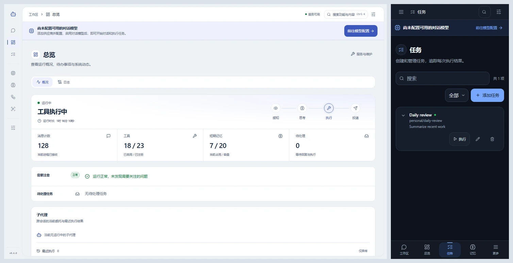

# AnelfAgent 前端体验与可靠性评审

评审对象是 React WebUI 的 24 个核心路由定义、应用壳、公共控件，以及频道和实体贡献界面的接入方式。交互检查覆盖工作区、总览、记忆、配置、任务、心跳、模型和 MCP 等主要路径。桌面安装管理器另行做了源码检查。本次实现集中于 WebUI 和心跳保存服务。

## 最影响使用体验的三件事

1. **状态是否可信。** 用户看到「0」「空闲」「一切正常」时，会据此决定是否介入。原实现里，请求失败、快照缺字段和真实零值存在相同的展示。总览整块被一个辅助接口拖入错误页时，仍可操作的告警入口也随之消失。
2. **操作是否可恢复。** 表单需要让用户知道保存了什么、失败在哪里、输入是否还在。心跳页复制整份服务端配置，再用整份副本回写。改一个数值可能顺带提交已过时的任务列表，合法温度 0 也会变成默认值。
3. **空间是否留给当前任务。** 宽屏适合并排观察，手机首屏适合呈现一项明确任务。原模型引导在窄屏分成标题、说明、按钮三层，多个页面的正文都被推低。粗细一致的卡片边框、过小的元信息和重复的页名，也会减弱主次关系。

## 已落实的改动

| 范围 | 原有问题 | 现在的行为 |
| --- | --- | --- |
| 运行总览 | 组件请求失败影响整个概览，无法取得阶段时默认空闲，思维快照为空对象时显示 0/0 | 组件、运行状态和思维快照独立反馈。读不到的指标显示「—」或「暂不可用」，获取到的真实 0 仍显示为 0。运行时长从最近的服务端采样和采样时间计算。 |
| 告警与管理列表 | 任一告警源异常会盖住其他有效告警。MCP 管理和总览使用不同缓存键，任务刷新失败仍像最新列表 | 告警保留可用来源，重试只针对失败来源。总览复用 MCP 管理页的查询。任务和 MCP 列表保留上次数据并说明刷新失败，首次读取前隐藏结果数。 |
| 心跳配置 | 表单副本、独立调度副本、查询数据三处持有相同内容。切页可丢失编辑，接口拒绝某条调度时，其他字段可能已生效 | 以查询数据为底，只覆盖并提交改动字段。空输入可编辑，0 可保存，失败保留草稿，离开时可继续编辑。重复空闲调度在页内说明，后端在写间隔和改变运行中配置前先解析并校验调度。 |
| 导航与命令面板 | 浏览器标签标题遗漏动态详情和插件页面。移动菜单点击当前页可能不收起，命令面板关闭时直接卸载 | 浏览器标题与导航复用路由匹配，文档语言随中英文切换。移动端完成导航后关闭抽屉，二级页点亮「更多」。命令面板按需加载，退出动画和焦点恢复交由共享弹层处理。 |
| 移动适配与反馈 | 手机设置引导挤占正文，任务行的操作和标题争抢宽度，多个长通知可能遮住操作区 | 窄屏保留引导标题和设置入口，说明仍可由读屏软件读取。窄任务卡的操作另起一行。通知区限制最大高度，关闭按钮按语言和指针类型适配，错误与普通通知使用不同的播报优先级。 |
| 视觉与动效 | 总览四个阶段依赖数字和颜色辨认，导航变化和实时运行反馈缺乏区分 | 感知、思考、执行、回复分别有图标和文字，当前阶段同时提供读屏语义。阶段激活和导航选中时有短反馈，普通刷新不重播。动效沿用系统减少动态效果偏好。 |
| 深色主题 | 深色卡片上的错误文字对比度约 4.44∶1，信息文字在悬停底色上约 3.68∶1。部分实心操作按钮直接复用状态文字色 | 调整深色错误和信息令牌，两处对应值分别提高到 6.04∶1 和 5.32∶1。挂断按钮使用实心危险操作底色，已保存状态使用轻底色，合并操作复用主要按钮的前景色。数值按项目实际 sRGB 颜色计算。 |
| 工作区与按需加载 | 尺寸变化会重复读取持久化布局，部分测量重复发布相同尺寸。首次进入记忆页会连带加载 Cognee 管理面板 | 相同面板组合复用解析后的布局，尺寸不变时复用原状态。Cognee 在对应页签内加载，下载过程中保留页签导航。 |

## 后续优化优先级

| 优先级 | 证据与影响 | 建议和验收方式 |
| --- | --- | --- |
| 高 | 自定义子代理编辑集中在 `CustomAgentSection.tsx`。Schema 校验调用浏览器 `alert`，创建、保存和删除使用异步事件处理器与 `finally`。服务端错误有全局提示，事件处理器仍可能产生未处理的拒绝。 | 把创建与编辑拆成独立表单，用字段级错误定位 Schema，用一个 mutation 管理每种写入。验收非法输入、保存失败重试、保存期间重复按 Enter，检查草稿与焦点。 |
| 高 | 心跳基础字段现在按改动提交。编辑调度仍需发送整张调度表，表内同时包含运行时的节拍计数。多个管理端同时编辑同一份调度仍有旧值覆盖风险。 | 为调度编辑增加修订检查，或按任务提交配置变更，并把「重置计数」作为明确意图。用两个页面同时编辑并跨过一次真实节拍验收。 |
| 高 | 状态页与工作区的数据来自轮询和事件流。「HTTP 服务可达」「运行时已就绪」「实时事件流已恢复」是三个独立事实。顶栏的可用性指示在很窄的屏幕上隐藏。 | 手机端给异常和重连保留可发现的入口。统一关键状态面板的采样时间和过期提示。验收断网、仅事件流中断、恢复网络以及后台标签页回到前台。 |
| 中 | 记忆页有 13 个并列页签。溢出箭头解决了可达性，用户仍需记住便签、图谱、召回策略和索引维护分别在哪里。 | 按「浏览内容」「理解召回」「管理索引」一类的实际任务组织入口。以现有深链和浏览器后退为兼容条件，观察新用户首次找到目标的操作次数。 |
| 中 | 桌面首次访问默认收起侧栏，收起态还会筛掉部分入口。熟悉图标的用户能更快进入工作区，新用户往往要先发现展开按钮或命令面板才能找到低频功能。 | 在宽屏首访测试展开侧栏，继续尊重已保存的偏好。用「找到频道配置」「进入凭据管理」两项任务比较完成率、点击数和留给工作区的宽度。 |
| 中 | 日志来源、运行历史和文件树中多处元信息使用 9–11 px。总览和管理页都有标题、卡片、附注，视觉权重接近。 | 先在日志和执行详情提高决策信息字号与行高，把时间和标识符作为次级信息。用留白、分隔线和数字对齐区分层级。以长中文、长英文、低对比屏幕和 200% 缩放检查。 |
| 中 | 工作区侧重连续阅读，管理页侧重判断和修改。相同的卡片边框、阴影和强调色在多个层级重复，状态、推荐入口和主要动作容易争夺注意力。 | 让实时执行以阶段和时间为视觉主线，让管理表单以字段组和唯一主操作为主线。将后续动效用于保存状态变化、面板展开和回到阅读锚点。用快速切换、持续数据刷新和减少动态效果三种状态验收。 |
| 中 | `TabBar` 已支持方向键、Home、End 和选中项滚动，但通用页签与内容区缺少一致的 `aria-controls` / `tabpanel` 关联。文件树还有英文硬编码的状态名称。 | 给页签与内容区建立稳定关联，保留会话切换等非标准页签的原有语义。对文件树做中英文读屏走查，覆盖状态徽标和更多菜单。 |
| 中 | 全局通知已有数量上限和去重，阅读时间取决于固定时长。高信息量错误可能在键盘用户读完或操作前消失。 | 悬停和键盘焦点期间暂停自动关闭。关键失败保留就地错误和重试入口。覆盖多条通知同时出现、Tab 导航和弹窗内操作。 |
| 中 | 语法高亮、电子表格解析和文件编辑器有独立资源。生产构建中 C++ 高亮资源超过 500 kB。路由主脚本大小不能代表打开某份文档的总成本。 | 在打开代码、表格和大文件时分别采集请求字节、解析长任务、堆和滚动延迟。按资源实际加载时机分配预算，保留可读原文和按需增强。 |
| 中 | 持续跟随最新消息时，本机样本稳定在 120 条。主动展开到 920 条历史时，页面节点增至约 2 万个，GC 后堆增至约 37 MiB。此时的成本来自用户确实打开的历史。 | 优先评估长会话向上翻页时的分段渲染。以复制原文、定位代码块、保持阅读位置和返回最新消息后释放节点为验收条件。 |
| 中 | 浏览器基线覆盖桌面和手机 Chromium。手机模拟无法还原 iOS 输入法、系统字号、刘海和原生选择器的全部行为。 | 用 iOS Safari、Android 真机和高缩放桌面复测输入框、弹层、多列面板和后台恢复。重点观察键盘弹出后的可见操作区、焦点归还和列表阅读位置。 |
| 低 | 桌面启动器使用独立的深色主题和安装状态模型，`app/ui/app.js` 同时承担状态读取、渲染与用户动作，每 1.5 秒触发一次刷新。它还有托盘状态同步职责。 | 后续独立梳理安装、运行和退出三种状态。测量隐藏窗口时的 CPU 和请求数，区分托盘所需更新和可见界面绘制。统一产品配色语义与操作命名，保留安装器自己的启动路径。 |

## 验证口径

- 同一台机器的 Vite 生产构建，记忆页路由脚本由 **120.57 kB 降至 64.07 kB**，gzip 由 **28.61 kB 降至 15.74 kB**。Cognee 页签独立脚本为 57.57 kB，gzip 为 14.15 kB。该比较只计这一个路由脚本。
- 全量常规浏览器回归 361 项通过，9 项按设备或性能开关跳过。随后按需加载调整的定向回归 59 项通过，最终配色构建的定向回归 53 项通过，两项性能场景另行启用并通过。前端单元测试 244 项、模块脚本测试 7 项、心跳后端测试 53 项通过。ESLint、两份 TypeScript 工程、Ruff、9 项导入边界和生产构建通过。
- 实际渲染工作区、总览、任务和配置，在 320×568、390×844、768×860、844×390、1440×960 五种视口检查页面和主内容区，共 20 组。横向溢出均为 0 CSS px。有模型引导的 320 和 390 宽度样本中，引导高度为 53 CSS px。表格、代码块、页签等有意设置的内部滚动单独验收。
- 浏览器回归使用生产资源和受控 API，覆盖中英文、明暗主题、键盘与触屏、局部故障、失败重试和草稿保护。另对本机已运行服务读取运行状态、思维快照、心跳配置和 MCP 目录，核对实际返回结构。写入类验收均在隔离测试中完成。
- 桌面 Chromium 连续 90 秒接收 880 条消息、7,040 个文件事件。事件分发到经过两次动画帧的 P95 为 60 ms，持续流量阶段记录到 0 个长任务和 0 个页面错误。展开历史后返回最新消息，渲染数从 920 降回 40，页面节点从 20,136 降至 4,197，GC 后堆从 37.36 降至 14.77 MiB。
- 另一个冷开样本含 40 条消息，每条有 120 行代码。40 条消息节点出现耗时 405 ms，该场景仍有一次 66 ms 的长任务。这些数字是本机隔离测量，线上设备、网络和模型耗时需单独采样。
- 本报告中的桌面启动器结论来自源码。截图使用测试数据，构建及浏览器性能数字应按相同机器、构建模式和输入规模复测。
- 上述首轮数据取自评审时的工作区。仅导出本次提交范围后，独立构建的记忆页路由脚本为 63.60 kB，gzip 为 15.60 kB。该快照的 243 项前端单测、7 项模块测试及 110 项心跳与配置接口相关后端测试通过。
